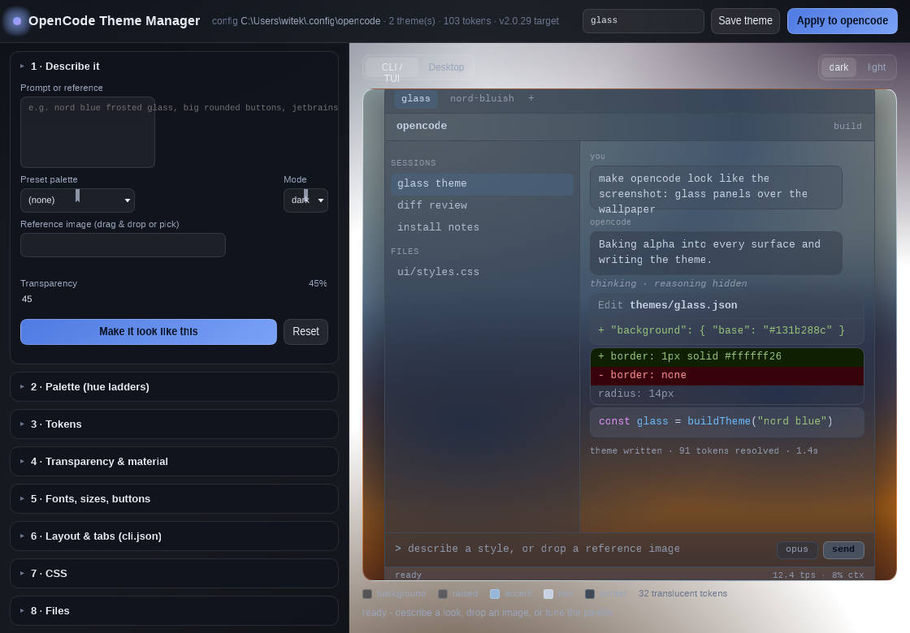

# OpenCode Theme Manager

Describe a look in words, drop in a reference image, and this writes a real
[opencode](https://opencode.ai) theme - glass surfaces over your wallpaper, hue ladders, fonts,
button geometry and CSS - then applies it to the CLI and to the web/desktop client.

Zero dependencies. Node 18+ and a browser. Nothing is installed, nothing is uploaded; the server
binds `127.0.0.1` and every file it overwrites is backed up first.



## Run it

```powershell
node server.mjs            # opens http://127.0.0.1:4289/
```

or double-click `start.cmd`. Options: `--port 4289`, `--no-open`, `--config-dir <path>`,
`--terminal-settings <path>`.

Install it as an app (copy + Desktop shortcut, no npm):

```powershell
powershell -ExecutionPolicy Bypass -File .\install.ps1     # -> %LOCALAPPDATA%\Programs\opencode-theme-manager
powershell -ExecutionPolicy Bypass -File .\uninstall.ps1   # removes the app + shortcut, keeps your themes
```

## Using it

**In the browser UI, three clicks:**

1. *1 · Describe it* - type `nord blue frosted glass, rounded corners, 45% transparent`, press
   **Make it look like this**. (Or drop a reference image; the palette is read from it.)
2. Name it in the top bar, press **Save theme**.
3. Press **Apply to opencode**. Then restart opencode.

**Or from the terminal, one command:**

```powershell
node tools/apply.mjs --name glass --prompt "nord blue frosted glass, 45% transparency" --terminal
```

`--terminal` also writes Windows Terminal `opacity`/`acrylic`, which is what makes the wallpaper show
through. Add `--font "JetBrains Mono" --font-size 13` if you want the font written too.
`--file examples/glass.json` applies a theme you already have.

## The desktop app (the GUI, not the TUI)

If your opencode is the **desktop app** (`@opencode-aidesktop`, `OpenCode.exe`), that app does *not*
read your TUI theme file. It is a Chromium shell around the opencode web client with **its own 36
bundled themes** (`oc-2`, `nord`, `tokyonight`, ...) and no config file for them - verified against
its own `resources/app.asar`: the only levers are three `localStorage` keys its preload script reads.

| Lever | Key | What it does |
|---|---|---|
| GUI theme | `opencode-theme-id` | picks one of the bundled themes |
| GUI CSS | `opencode-theme-css-dark` / `...-light` | raw CSS injected into the app on startup |

Driving `localStorage` needs a DevTools port, so the app has to be started once with
`--remote-debugging-port=9222`. One command does the restart, the injection and the reload:

```powershell
node tools/desktop-apply.mjs --list                # is the app installed, which themes ship, is a port open
node tools/desktop-apply.mjs --glass --restart     # restart with DevTools + inject the glass CSS
node tools/desktop-apply.mjs --theme-id nord       # just switch the GUI to a bundled theme
node tools/desktop-apply.mjs --clear               # back to the app's own settings
```

In the manager UI the same thing lives under **7 · Desktop app (GUI)**: it lists the bundled themes,
injects the CSS built from your current palette and fonts, and can restart the app for you.

The injection refuses to touch anything that is not the app: a candidate page is only written to if
its preload has set `data-theme` on `<html>` (or the theme id is already stored), so a browser tab
that happens to expose a debug port is left alone.

**What the GUI can and cannot do.** Colours, fonts, radius and translucency *inside* the window are
CSS, so they work. True wallpaper see-through needs a transparent window, which the app does not
expose; the closest honest equivalent is a translucent surface stack over a dark base. The app also
reads `backgroundColor` from `%APPDATA%\ai.opencode.desktop\opencode.settings` for its window fill -
that one is a plain file, no DevTools needed.

### "I applied it but opencode looks the same"


Work down this list - each line is a thing that has to be true:

1. **Restart opencode.** The TUI reads `cli.json` at startup; a running session will not repaint.
2. **Check the pointer:** `<config>/cli.json` must say `"theme": { "name": "<your theme>" }`. The
   manager writes exactly that, and prints the path it wrote.
3. **Check the file landed:** `<config>/themes/<name>.json`, and it is V2 (`base` + `dark`/`light` at
   the top level). `node tools/check.mjs <file>` validates it.
4. **Tabs vs. panes:** the theme colours the whole TUI. If only *some* panes changed, you applied the
   theme but not the terminal settings - `Tools → Apply` only writes the theme; transparency needs
   step 5.
5. **Transparency needs the terminal too.** Windows Terminal: `"opacity": 70, "useAcrylic": true` on
   your profile (the manager writes it under *4 · Transparency & material*). Without that, a
   translucent theme looks flat, because nothing behind it is being composited.
6. **A project theme can override yours.** `<project>/.opencode/themes/<same-name>.json` wins over the
   global one. Also `--project`-level `opencode.json` can pin a theme per project.
7. **Still stuck?** `opencode debug config` shows which config documents are being read, and
   `~/.local/share/opencode/log/opencode.log` records CLI-side errors including theme parse failures.

### Undo

Every write is backed up. Restore by copying the newest `*.bak.<timestamp>` sibling back:

```powershell
Copy-Item "$env:USERPROFILE\.config\opencode\cli.json.bak.20261015-222223" "$env:USERPROFILE\.config\opencode\cli.json" -Force
```

Setting `"theme": { "name": "opencode" }` (or `"system"`) returns to stock colours.

## Scale notes

- The theme model is data-driven: 103 token paths, 11 hues x 9 steps per mode, generated. Nothing is
  hardcoded per theme name.
- Any number of themes: every `*.json` in `<config>/themes` is listed on load; project themes are read
  from the same directory layout opencode uses.
- Any config dir: `--config-dir`, `OPENCODE_CONFIG_DIR`, `XDG_CONFIG_HOME` or the Windows default.
- Portable: the only platform-specific feature is the Windows Terminal write; on macOS/Linux it
  reports the candidates it looked for and the rest of the app works unchanged.
- No dependencies, no build step, no network calls, no telemetry.


## What it does

**1 · Describe it.** Type `nord blue frosted glass, big rounded buttons, jetbrains mono, 60% transparent`
and press *Make it look like this*. The prompt interpreter maps words to hues, transparency, radius,
font and density, and prints the words it understood, so nothing is a black box. Or drop an image:
the palette is extracted in your browser (canvas, no upload) and mapped to background / text / accent
roles - each swatch stays editable.

**2 · Palette.** Eleven hue slots per mode. Pick one colour per slot; the nine steps of the ladder are
generated in OKLCH, in opencode's own direction (light themes run dark at `100` to light at `900`,
dark themes the other way).

**3 · Tokens.** All 103 tokens opencode v2 knows about (59 required leaves + 44 optional states),
each one overridable with hex, `transparent`, or a `$hue.*` / `$text.*` reference.

**4 · Transparency.** A dark and a light surface-transparency slider. Alpha is baked into every
`background.*` token as 8-digit hex (`#0f1115d9` = 85% opaque), which opencode accepts, so the wallpaper
really shows through. Plus real Windows Terminal `opacity` / `useAcrylic` writes - the compositor is
what makes terminal transparency visible.

**5 · Fonts, sizes, buttons.** Font face and size, line height, corner radius, padding, button size and
alignment, sidebar width, header and status heights. These drive the live preview and the exported
`preview.css`, and the font face writes into your Windows Terminal profile.

**6 · Layout & tabs.** The knobs opencode actually has - `session.sidebar`, `session.scrollbar`,
`tabs.mode/scope/layout/indicators`, `diffs.view/tree`, `cursor.style`, `animations`, `mouse` - written
into `cli.json`.

**7 · CSS.** A CSS box applied live to the preview, exportable as `preview.css`, plus a
*Copy web/desktop snippet* button that seeds the `localStorage` keys the opencode web/desktop client
restores custom CSS from.

**8 · Files.** Save, load, import (V2 or legacy V1), export.

## Honest limits

opencode v2.0.29 has no font, geometry or CSS settings of its own - that was reverse-engineered, not
assumed: see [`docs/opencode-client-re.md`](docs/opencode-client-re.md) for the evidence table
(quoted strings from the 212 MB binary, upstream source paths, and what was searched for and *not*
found). So:

| What you asked for | Where it lands | Effect |
|---|---|---|
| theme colours, alpha | `<config>/themes/<name>.json` (V2) + `cli.json` `theme.name` | real, immediate after restarting opencode |
| transparency | 8-digit hex in the theme + Windows Terminal `opacity`/`useAcrylic` | real; the theme supplies alpha, the terminal supplies the blur |
| fonts | Windows Terminal `profiles.*.font` | real for the CLI; the TUI never sets fonts |
| button positions / sizes, CSS | preview + `preview.css` + the web/desktop client's `localStorage` CSS hook | preview is exact; the *TUI* has no such hook and no amount of config changes that |
| layout | `cli.json` (`session.sidebar`, `tabs.layout`, `diffs.view`, ...) | real, and that is the complete list |

## Files it touches

| Thing | Path |
|---|---|
| Theme | `<config>/themes/<name>.json` |
| Theme selection, layout | `<config>/cli.json` → `theme.name`, `theme.mode`, `tabs`, `diffs`, `session`, ... |
| Desktop/web CSS copy | `<config>/theme-manager/desktop.css` |
| Backups | next to each file, as `<file>.bak.<yyyymmdd-hhmmss>` |
| `<config>` on Windows | `C:\Users\<you>\.config\opencode` |

## Checks

```powershell
node --test test/          # 46 tests: schema, hue ladders, transparency, prompt/image design, full API round-trip
node tools/check.mjs       # validates the shipped example themes + all 35 presets
node tools/serve-smoke.mjs # boots the server against the real config, read-only, writes nothing
node tools/make-examples.mjs  # regenerates examples/glass.json, glass-v1.json, preview.css
```

`test/server.test.mjs` drives the API against a throwaway config dir, so running the tests never
touches your real themes, `cli.json` or Windows Terminal settings.

## Theme format

The manager emits opencode's V2 document shape (mirrored from
`packages/theme/src/tui/schema.ts`):

```json
{
  "$schema": "https://opencode.ai/theme.json",
  "base": { "categorical": ["accent", "purple"], "text": { "base": "$hue.neutral.200" }, "...": "..." },
  "dark": { "hue": { "neutral": { "100": "#95a1b5", "...": "#131c29" }, "accent": "$hue.blue" },
            "background": { "base": "#2e34408c" } }
}
```

Values may be 3/4/6/8-digit hex, `"transparent"`, or a `$`reference. Legacy V1 themes (flat 52-token
files, like the 35 bundled presets and anything already in your themes folder) are imported on a
best-effort name mapping and converted on the way in.

## Crediting the reverse engineering

`docs/opencode-client-re.md` records how each claim was checked, including what was *not* found:
`"opacity"`, `"acrylic"`, `desktop.css`, `user.css`, `OPENCODE_THEME` - zero matches in the v2 binary;
the only CSS hook is `packages/app/public/oc-theme-preload.js` reading `localStorage`. The rea
(`reverse-engineer-anything`) and ConardLi/garden-skills skill sets used for the investigation and the
design pass live in `~/.agents/skills`.

MIT.
